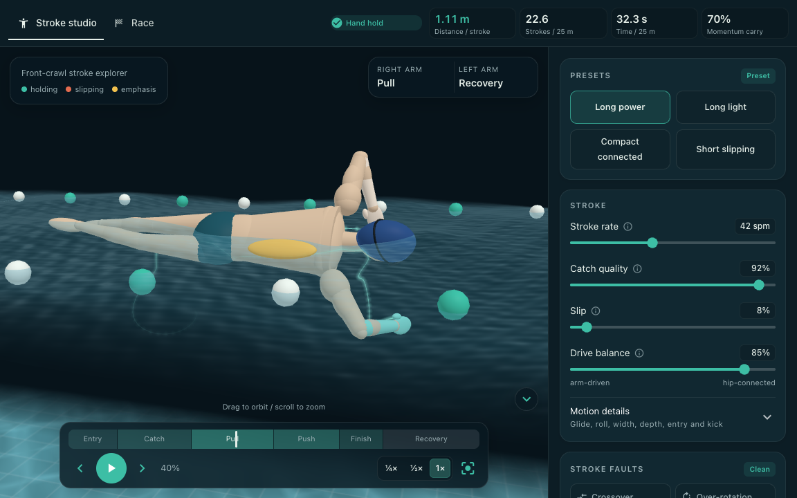
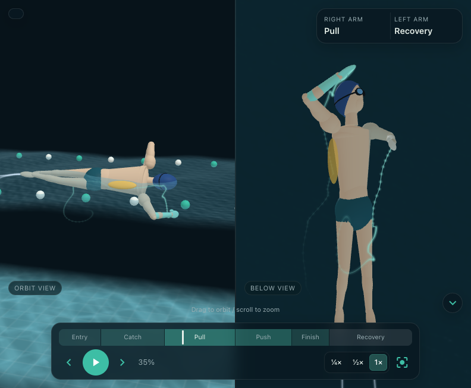

<h1 align="center">Long Catch</h1>

<p align="center">
  <strong>An interactive 3D explorer for front-crawl stroke technique.</strong><br>
  Shape a stroke, inspect common faults, and compare two swimmers over 25–100 m.
</p>

<p align="center">
  
  
</p>

<p align="center">
  
</p>

Explore a procedural swimmer in **Stroke studio** or compare setups in **Race**.
Runs locally with Python and [NiceGUI](https://nicegui.io), without accounts,
cloud services or downloaded models.

## Gallery

<table>
  <tr>
    <td align="center" width="33%">
      <br>
      <sub><b>Split view</b> with motion trails.</sub>
    </td>
    <td align="center" width="33%">
      <br>
      <sub><b>Stroke faults</b> with coaching cues.</sub>
    </td>
    <td align="center" width="33%">
      <br>
      <sub><b>High-elbow catch</b> from underwater.</sub>
    </td>
  </tr>
</table>

## Features

- **Stroke controls:** eleven settings, four presets and eight combinable faults
  with coaching cues. The default distance stroke combines kick-led hip roll,
  a two-beat kick, short glide and adjustable-width high-elbow "power diamond"
  pull. All faults start off; Crossover is optional.
- **Inspection:** orbit and split cameras, hand/foot trails, muscle highlighting,
  simulated **water pressure**, slow playback and a six-phase timeline.
- **Feedback:** live distance-per-stroke, stroke-count, pace and momentum-carry
  estimates. Hands turn teal when holding water and coral when slipping; amber
  highlights muscle emphasis.
- **Water and motion:** stroke-driven ripples, spray, bubbles and wake, with
  natural breathing and lightweight water reactions. Hand angle, submerged
  forearms and slip affect visual thrust; drag slows the glide. Uneven pulls
  turn and drift the body, while buoyancy and kicks gently adjust its balance.
  Submerged downbeats add modest thrust; wide, knee-bent kicks add resistance.
  These reactions do not change pace estimates or race results.
- **Race:** solo or two-swimmer comparisons over 25, 50 or 100 m, with distance
  tracks, finish times and a winning margin.

## Quick start

**Requires Python 3.12.** Open the cloned/downloaded folder in a terminal.
Create and activate a virtual environment:

**Linux / macOS**

```bash
python3.12 -m venv .venv
source .venv/bin/activate
```

**Windows (Git Bash)**

```bash
py -3.12 -m venv .venv
source .venv/Scripts/activate
```

**Install and run**

```bash
python -m pip install -r requirements.txt
python main.py
```

Open <http://127.0.0.1:8080>. Stop with <kbd>Ctrl</kbd>+<kbd>C</kbd>.
To relaunch, activate the environment and run `python main.py`.

### Deploy to Render

Local use needs no login. Setting `PORT` or `RENDER` enables authenticated hosting.

1. Install requirements, then generate an **Argon2 password hash** (hidden input):
   ```bash
   python -c "from getpass import getpass; from argon2 import PasswordHasher; print(PasswordHasher().hash(getpass('New password: ')))"
   ```
2. Generate a separate **session secret**:
   ```bash
   python -c "import secrets; print(secrets.token_urlsafe(48))"
   ```
3. In Render, choose **New → Blueprint**, connect this repository and select
   `main`. The root `render.yaml` configures the free `long-catch` service.
4. Enter these values only in Render's secret environment-variable fields:
   - `APP_USERNAME`: your chosen username.
   - `APP_PASSWORD_HASH`: the complete generated hash, not the password.
   - `SESSION_SECRET`: the generated secret (at least 32 characters).
5. Deploy. `python main.py` listens on `0.0.0.0:$PORT`.
   `/health` is public and returns only `{"status":"ok"}`. Open the HTTPS
   `.onrender.com` URL and sign in.

Render supplies HTTPS; don't use self-signed certificates or bypass warnings.
Local use remains HTTP.

**Updating:** pushes to the linked `main` branch deploy automatically when
Auto-Deploy is enabled. Otherwise, open the service and choose **Manual Deploy →
Deploy latest commit**. Wait for **Live**, check the deployed commit, then refresh
the site and sign in again.

Hosted mode requires valid authentication settings. Pages, assets and live
connections require login. Sessions expire after 12
hours; **Sign out → Sign out** revokes the session and its open connections.
Cookies are Secure, HttpOnly and SameSite=Lax. Login attempts are rate-limited.
Use one instance/process: sessions and limits are in memory.
Restarts sign everyone out; credential changes require a restart.

Free services may take a minute to wake. Settings and race history are temporary;
reloads/restarts reset them. This is **not a web crawler** and needs no server-side
Chromium/Playwright. Keep credentials out of Git, logs and screenshots.
`.env` files are ignored and unnecessary locally. After deployment, test login,
both tabs, logout and private-tab access, including on iPhone.

## Usage

### Stroke studio

1. Pick one of four presets; edits change its label to **Custom**.
2. Tune **rate**, **catch**, **slip** and **drive**; estimates update above them.
   Expand **Motion details** for glide length, roll, pull width, depth, entry angle, kick size
   and kick timing (2-, 4- or 6-beat).
3. Enable **stroke faults** to compare technique; **Clear** removes them all.
4. Drag to orbit, scroll to zoom, or enable **Split view** (Top, Side, Front or
   Below). Add hand/foot trails, or enable **Water pressure** to see warm clouds
   build after the catch and dissipate downstream.
5. Scrub to pause at **Entry → Catch → Pull → Push → Finish → Recovery**,
   or slow playback. **Play** resumes.

Live estimates stay pinned in the same row as the Studio / Race tabs, so they
remain visible while scrolling the controls. Narrow screens use shorter metric
captions and icon-only tabs to keep the bar compact. In Race the estimates
follow the selected swimmer, labelled A or B; returning to Studio restores
the studio estimates.

Each hand entry counts as one stroke; a full arm cycle contains two.
More slip reduces distance per stroke, and extra drive cannot rescue a poor catch.
A low rate lengthens the unpropelled glide, reducing momentum carry and distance
per stroke.

**Glide length** adjusts the front-end hold independently of rate: 50% keeps the
normal stroke, lower values catch earlier, and higher values hold longer.
It is a timing control, not metres; longer glides also reduce estimated momentum
and distance per stroke. The kick-led roll follows the catch.

Watch the swimmer against the lane buoys to see pull-driven acceleration and
coasting. Compare Crossover from the Top split view for heading and sideways
travel. Motion stays within a small viewing window; it is not free navigation.

Compare **Kick amplitude** at 0%, 45% and 100% against the lane buoys, or use
the Side view to see the small balance response. Two-beat kicks give spaced
impulses; four- and six-beat kicks spread the support through the stroke.
Bigger kicks are not a speed shortcut, and **Knee kick** wastes more of the effort.
At 0% the legs stop kicking (unless the Knee kick fault is enabled).

### Race

1. Choose **25 m**, **50 m** or **100 m**, then **Solo** or **Two swimmers**.
2. Select **Swimmer A** (teal) or **Swimmer B** (amber) to edit independent
   settings and faults. **Use studio setup** copies your studio stroke;
   **Copy A to B** matches both lanes.
3. **Start race**, pause/resume, or **Reset race**. Playback at **1x**, **2x**
   or **4x** changes viewing speed, not simulated finish times.
4. Compare the lead, finish times and winning margin.

Setup, distance or swimmer-count changes reset the race; lane selection and
identical setups don't. Leaving Race pauses it. Studio remains independent.

**Model limits:** steady-speed races omit dives, turns and fatigue.
Roll, pull width, depth, entry angle and kick affect appearance, not
estimated speed. Water effects, pressure and buoyancy are visual only and never
alter results. Visual speed varies with the pulls; race progress and finish
times use the steady-speed estimate.

### Keyboard shortcuts

| Key | Action |
| --- | --- |
| <kbd>Space</kbd> | Play or pause |
| <kbd>←</kbd> / <kbd>→</kbd> | Step through the studio stroke |
| <kbd>1</kbd>–<kbd>4</kbd> | Select a studio preset |
| <kbd>C</kbd> / <kbd>V</kbd> | Reset studio camera / toggle split view |
| <kbd>P</kbd> | Pin the swimmer while scrolling the settings (narrow layout) |
| <kbd>H</kbd> | Hide or show the playback controls |

Shortcuts respect focused controls. Timeline arrows step 5%; Home/End seek
the start/end.

### Try it

<details open>
<summary><b>Compare two strokes over 50 m</b></summary>

Race **Long power** against **Short slipping**. To isolate slip,
copy A to B, then adjust B's slip.


</details>

<details open>
<summary><b>Inspect the underwater push</b></summary>

Choose **Long power**, scrub to **Push** (about 60%) and select **Triceps**.
Orbit the hand; step forward to inspect release.


</details>

<details open>
<summary><b>Check the catch from below</b></summary>

Enable **Split view → Below** and **Hands** trails. Inspect **Catch**, then
compare the **Crossover** entry.


</details>

## Development

```bash
python -m pip install -r requirements-dev.txt
python -m pytest -q
ruff check .
ruff format --check .
```

Tests cover timing, efficiency, faults, races, buoyancy and validation.
For UI changes, check both tabs, lane isolation, playback, scrubbing, cameras
and narrow layouts in a browser.
Restart the server after JavaScript or CSS edits.
With an existing `playwright-cli` installation and the server running, run the
water-motion and pinned-estimate browser checks from `tests`:

```bash
playwright-cli -s=motion open http://127.0.0.1:8080/
playwright-cli -s=motion run-code --filename=browser_motion.js
playwright-cli -s=motion run-code --filename=browser_estimates.js
playwright-cli -s=motion close
```

Water animation caches wave shapes, bounds ripple calculations and skips
unchanged paused frames without reducing surface detail.

`main.py` starts the app; `long_catch/model.py` owns pure maths,
`app.py` owns settings and UI, and `swimmer.py` builds the scene.
The browser's `static/engine.js` animates it; `static/race.js` shares a clock
between lanes. See [AGENTS.md](AGENTS.md) for architecture and contribution rules.