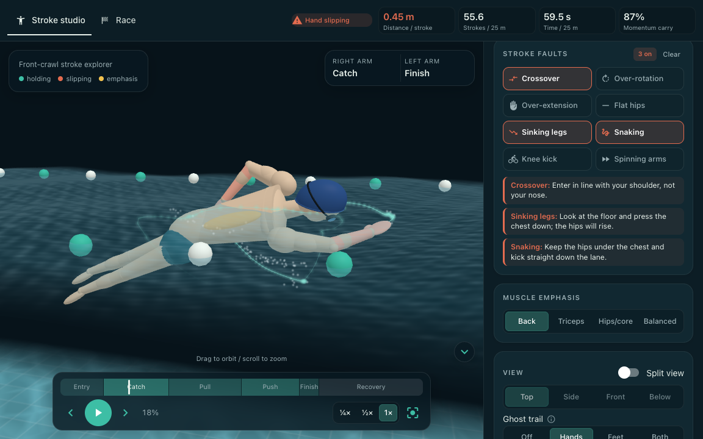
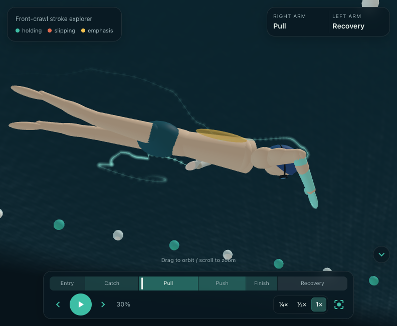
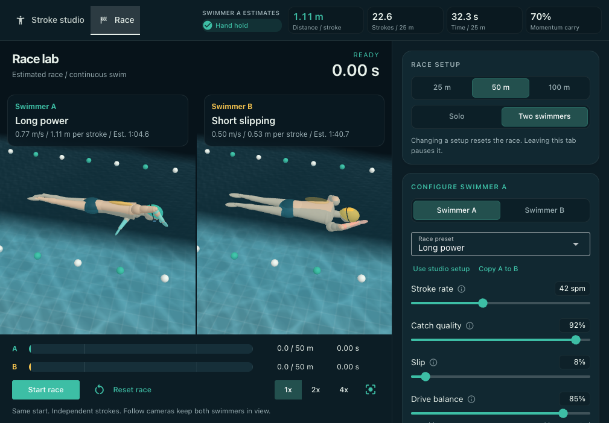
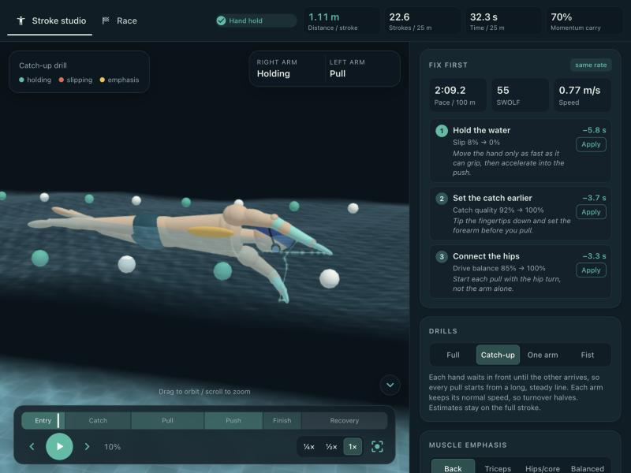
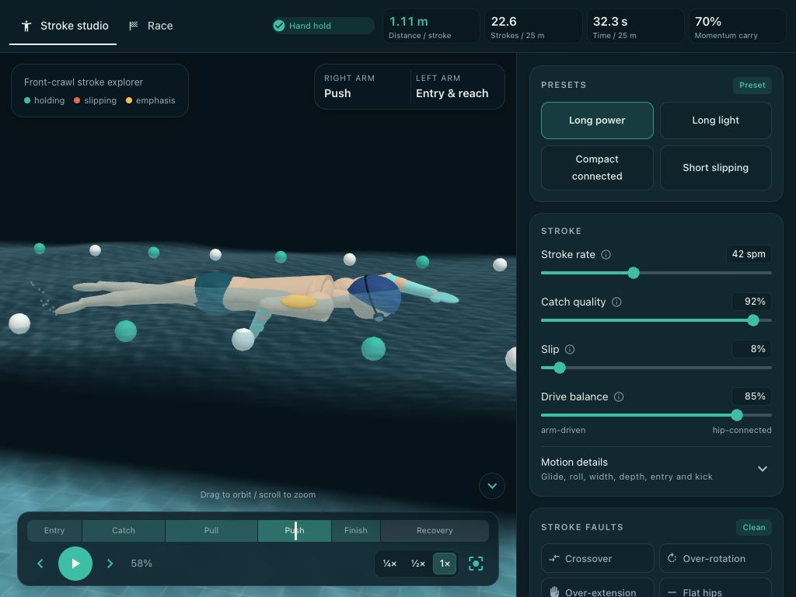
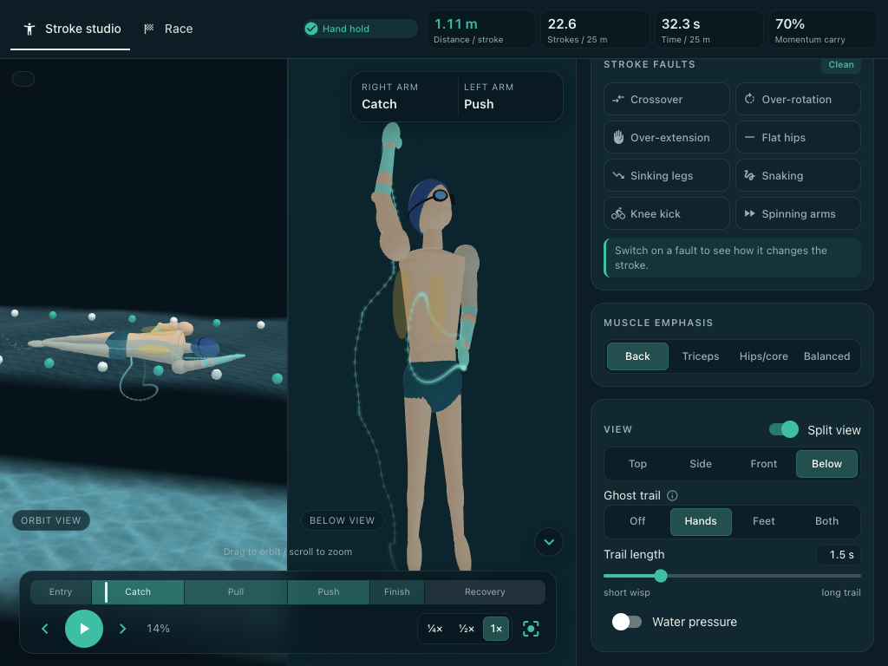

<h1 align="center">Long Catch</h1>

<p align="center">
  <strong>An interactive 3D explorer for front-crawl stroke technique.</strong><br>
  Shape a stroke, find what to fix first, practise drills, and compare two swimmers over 25–100 m.
</p>

<p align="center">
  
  
</p>

<p align="center">
  
</p>

Explore a procedural swimmer in **Stroke studio** or compare setups in **Race**.
Runs locally with Python and [NiceGUI](https://nicegui.io), without accounts,
cloud services or downloaded models.

## Gallery

<table>
  <tr>
    <td align="center" width="33%">
      <br>
      <sub><b>Split view</b> with motion trails.</sub>
    </td>
    <td align="center" width="33%">
      <br>
      <sub><b>Stroke faults</b> with coaching cues.</sub>
    </td>
    <td align="center" width="33%">
      <br>
      <sub><b>High-elbow catch</b> from underwater.</sub>
    </td>
  </tr>
</table>

## Features

- **Stroke controls:** thirteen settings (including the swimmer's height), four
  presets and thirteen combinable faults with coaching cues, including **Head
  lift**, **Early exit**, **Dropped elbow**, **Lopsided pull** and **Early
  rotation**, plus three **Good form** cues (**Wrist press** and **Shoulder
  reach** fix the Dropped elbow: the palm presses back with the elbow high and
  the arm reaches long from the shoulder; **Hip finish & roll** pushes the
  water right back to the hip and turns hips and shoulders together about a
  still head). They help the estimates. Under **Equipment**, **Hand
  paddles** put a hand-sized plate on each palm: the hand holds more water, so
  each stroke carries further and the arm feels heavier, at a higher effort.
  The default
  distance stroke combines kick-led hip roll, a two-beat kick, short glide,
  bilateral breathing every three strokes, an adjustable-width high-elbow
  "power diamond" pull and a relaxed, elbow-led recovery: the hand leaves the
  water still moving, skims low under a high elbow and swings forward into a
  fingertips-first entry. All faults start off.
- **Fix first:** a coaching card that ranks the single changes worth the most
  time per 100 m at your current stroke rate (clear a fault, set the catch
  earlier, hold the water, connect the hips, shorten an over-long glide).
  **Apply** makes that one change. The card also shows pace per 100 m, SWOLF,
  speed and **effort**.
- **Drills:** the swimmer demonstrates **Catch-up**, **One arm** and **Fist**
  drills. Drills change the movement only; estimates stay on the full stroke.
- **Felt load:** the water you push back pushes back, so the arm feels heavier
  through the pull. A **Load** bar under each arm shows that sensation, and the
  swimmer moves to it: the hand slows through the heaviest water and the
  recovery speeds up to keep the stroke rate. A slipping hand feels light.
- **Inspection:** orbit and split cameras, hand/foot trails,
  simulated **water pressure**, a **water flow** view of slipping, an **anchor** view (a pin fixed in the water where the hand catches), a **cross-body link** view (shoulder to opposite hip; a loose core twists the trunk and loses drive), slow playback and a six-phase timeline.
- **Feedback:** live distance-per-stroke, stroke-count, pace, momentum-carry and
  effort estimates for rates from 22 to 72 spm. Hands turn teal when holding
  water and coral when slipping.
- **Water and motion:** a rolling swell, bow wave, V-shaped wake and fine
  scrolling surface ripples, plus stroke-driven ripples, spray and bubbles. The
  surface stays clear from above and catches more light when viewed across it.
  Natural breathing and lightweight water reactions add life. Hand angle, submerged
  forearms and slip affect visual thrust; drag slows the glide. Uneven pulls
  turn and drift the body, while buoyancy and kicks gently adjust its balance.
  Submerged downbeats add modest thrust; wide, knee-bent kicks add resistance.
  These reactions do not change pace estimates or race results.
- **Race:** solo or two-swimmer comparisons over 25, 50 or 100 m, with distance
  tracks, finish times and a winning margin.

## Quick start

**Requires Python 3.12.** Open the cloned/downloaded folder in a terminal.
Create and activate a virtual environment:

**Linux / macOS**

```bash
python3.12 -m venv .venv
source .venv/bin/activate
```

**Windows (Git Bash)**

```bash
py -3.12 -m venv .venv
source .venv/Scripts/activate
```

**Install and run**

```bash
python -m pip install -r requirements.txt
python main.py
```

It picks a free local port (8100–8899) and prints the address; open that, or set `LONG_CATCH_PORT=8080` to pin one. Stop with <kbd>Ctrl</kbd>+<kbd>C</kbd>.
To relaunch, activate the environment and run `python main.py`.

### Deploy to Render

Local use needs no login. Setting `PORT` or `RENDER` enables authenticated hosting.

1. Install requirements, then generate an **Argon2 password hash** (hidden input):
   ```bash
   python -c "from getpass import getpass; from argon2 import PasswordHasher; print(PasswordHasher().hash(getpass('New password: ')))"
   ```
2. Generate a separate **session secret**:
   ```bash
   python -c "import secrets; print(secrets.token_urlsafe(48))"
   ```
3. In Render, choose **New → Blueprint**, connect this repository and select
   `main`. The root `render.yaml` configures the free `long-catch` service.
4. Enter these values only in Render's secret environment-variable fields:
   - `APP_USERNAME`: your chosen username.
   - `APP_PASSWORD_HASH`: the complete generated hash, not the password.
   - `SESSION_SECRET`: the generated secret (at least 32 characters).
5. Deploy. `python main.py` listens on `0.0.0.0:$PORT`.
   `/health` is public and returns only `{"status":"ok"}`. Open the HTTPS
   `.onrender.com` URL and sign in.

Render supplies HTTPS; don't use self-signed certificates or bypass warnings.
Local use remains HTTP.

**Updating:** pushes to the linked `main` branch deploy automatically when
Auto-Deploy is enabled. Otherwise, open the service and choose **Manual Deploy →
Deploy latest commit**. Wait for **Live**, check the deployed commit, then refresh
the site and sign in again.

Hosted mode requires valid authentication settings. Pages, assets and live
connections require login. Sessions expire after 12
hours; **Sign out → Sign out** revokes the session and its open connections.
Cookies are Secure, HttpOnly and SameSite=Lax. Login attempts are rate-limited
per client (the address Cloudflare names in `CF-Connecting-IP`) under a
global cap, and requests started by other sites are refused, except plain links.
Use one instance/process: sessions and limits are in memory.
Restarts sign everyone out; credential changes require a restart.

Free services may take a minute to wake. Settings and race history are temporary;
reloads/restarts reset them. This is **not a web crawler** and needs no server-side
Chromium/Playwright. Keep credentials out of Git, logs and screenshots.
`.env` files are ignored and unnecessary locally. After deployment, test login,
both tabs, logout and private-tab access, including on iPhone.

## Usage

### Stroke studio

1. Pick one of four presets; edits change its label to **Custom**.
2. Tune **rate**, **catch**, **slip** and **drive**; estimates update above them.
   Expand **Motion details** for glide length, roll, head position, back arch, pull width, depth, entry angle, kick size,
   kick timing (2-, 4- or 6-beat), breathing (every 2–5 strokes) and the
   swimmer's height (150–200 cm; presets keep it).
3. Enable **stroke faults** to compare technique; **Clear** removes them all.
4. Drag to orbit, scroll to zoom, or enable **Split view** (Top, Side, Front or
   Below). Add hand/foot trails, or enable **Water pressure** to see warm clouds
   build after the catch and dissipate downstream.
5. Scrub to pause at **Entry → Catch → Pull → Push → Finish → Recovery**,
   or slow playback. **Play** resumes.
6. Read **Fix first** for the biggest wins at the same stroke rate, and
   **Apply** one to see the estimates and swimmer change.
7. Pick a **Drill** to watch a practice pattern (see below).

Live estimates stay pinned in the same row as the Studio / Race tabs, so they
remain visible while scrolling the controls. Narrow screens use shorter metric
captions and icon-only tabs to keep the bar compact. In Race the estimates
follow the selected swimmer, labelled A or B; returning to Studio restores
the studio estimates.

Each hand entry counts as one stroke; a full arm cycle contains two.
More slip reduces distance per stroke, and extra drive cannot rescue a poor catch.

#### How the estimates work

- **Thrust against drag.** Each stroke pushes the body and the water resists
  with drag that grows with the square of speed, so a higher rate is faster but
  each extra stroke per minute buys less. On the default stroke 42 spm swims
  about 1:46 per 100 m, 56 spm about 1:39 and 72 spm about 1:33.
- **Effort.** Rate is not free: effort is the stroke's work rate against an
  all-out sprint (72 spm with a full six-beat kick). The default stroke works at
  about 43%, 56 spm at 56% and 72 spm at 76%. Drag faults slow you without making
  the stroke easier; a slipping hand feels light and does less work.
- **Quick turnover slips.** Above 50 spm the hand has less time to set the
  catch, so it slips more, unless the catch is very good. A weak catch is
  fastest around 60 spm and slower again at the top rate.
- **Stroke length.** One curve sets the underwater path for every rate: slower
  strokes stay in longer, finish further back and, when the hand holds the water,
  carry further. On the default settings 22 spm covers about 2.17 m per stroke
  (≈11.5 strokes per 25 m, ≈2:06 per 100 m). A slipping hand gains much less
  from slowing down.
- **Momentum.** The hand drives for about 0.85 s per stroke (longer on a long
  path, shorter with an early exit or spinning arms); the rest is coast. A low
  rate or long glide coasts longer, and a draggy body slows faster while it
  coasts, so a long glide pays off only with a good streamline.
- **Body and legs.** Roll between about 35° and 55° is free; flatter or further
  adds drag. **Head position** between 0° (eyes on the floor) and 15° is free:
  lifted to look forward, the hips and legs sink (more so at pace); tucked chin to
  chest, the head buries and the front end dives. Outside that band a coral line
  shows where the swimmer is looking. Still legs sink a little; a kick lifts them and wins back part of
  the **Sinking legs** cost, which grows with pace (drag rises with speed squared; the legs sink deeper on screen too). A six-beat kick adds a little speed for a lot of
  effort, a big two-beat kick only adds drag, and **Head lift** costs more the
  more often you breathe.
- **Pull shape.** The high-elbow power diamond holds best. A hand wide of the
  shoulder, a deep straight arm, or the extremes of a hand crossing far under the
  body or held tight against it hold less water.
- **Height.** A taller swimmer covers more distance per stroke for the same
  effort (distance per stroke scales with height against 180 cm).

**Glide length** adjusts the front-end hold independently of rate: 50% keeps the
normal stroke, lower values catch earlier, and higher values hold longer.
It is a timing control, not metres; longer glides also reduce estimated momentum
and distance per stroke. The kick-led roll follows the catch.

Watch the swimmer against the lane buoys to see pull-driven acceleration and
coasting. Compare Crossover from the Top split view for heading and sideways
travel. Motion stays within a small viewing window; it is not free navigation.

Compare **Kick amplitude** at 0%, 45% and 100% against the lane buoys, or use
the Side view to see the small balance response. Two-beat kicks give spaced
impulses; four- and six-beat kicks spread the support through the stroke.
Bigger kicks are not a speed shortcut, and **Knee kick** wastes more of the effort.
At 0% the legs stop kicking (unless the Knee kick fault is enabled).

**Breathing** sets how many hand entries there are per breath. Odd counts
(3, 5) alternate sides; even counts (2, 4) always breathe to the right. Turn on
**Head lift** to see the common fault: the face lifts forward instead of
turning with the roll, the chest rises and the hips drop on every breath.

#### Felt load

Pushing water back makes the water push back on the palm and forearm, so
through the pull the arm feels heavier, as if it were lifting a weight. The
**Load** bar under each arm shows that sensation: empty during the reach and the
recovery, building through the catch, heaviest as the hand passes under the
shoulder, and released through the push. The better the hold, and the more the
hips connect the pull, the heavier it feels; a slipping hand stays light.

The swimmer moves to the load. The hand works more slowly through the heaviest
water, speeds up out of the back as the load lets go, and the weightless
recovery makes up the rest so the stroke rate holds: on **Long power** the hand
is about a quarter slower under the shoulder, about a quarter faster at the
exit, and leaves the water at about 80% of the cycle instead of 75%. Watch the timeline's **Recovery** segment move as you change catch, slip or
drive. The weight is a sensation only: it never changes buoyancy or the
estimates, which already count the hold behind it.

#### Fix first

Fix first scores each candidate change with the same estimate as the header and
lists the three biggest savings, in seconds per 100 m. Candidates are each
active fault, one 15-point step of catch, slip or drive, and a glide longer than
50%. It never changes the stroke rate, which is a pacing choice rather than a
technique fix. When nothing saves at least half a second per 100 m, the card
says so. **SWOLF** is strokes plus seconds for one 25 m length; lower is more
efficient. The four presets run from most to least efficient by SWOLF.
**Effort** is the stroke's work rate against an all-out sprint.

#### Drills

- **Catch-up:** each hand waits in front until the other arrives. Each arm keeps
  its normal speed, so turnover halves; the body holds on the side of the
  pulling arm and turns over during its recovery. The timeline follows the right
  arm, so its marker parks in **Entry** while that arm waits.
- **One arm:** the left arm stays long in front while the right arm strokes.
- **Fist:** closed hands make the forearm do the catching. With **Water
  pressure** on, the load moves from the hand up to the forearm.

Waiting arms read **Holding** in the arm panel. Drills apply to Stroke studio
only; races always swim the full stroke.

### Race

1. Choose **25 m**, **50 m** or **100 m**, then **Solo** or **Two swimmers**.
2. Select **Swimmer A** (teal) or **Swimmer B** (amber) to edit independent
   settings and faults. **Use studio setup** copies your studio stroke;
   **Copy A to B** matches both lanes.
3. **Start race**, pause/resume, or **Reset race**. Playback at **1x**, **2x**
   or **4x** changes viewing speed, not simulated finish times.
4. Compare the lead, finish times and winning margin.

Setup, distance or swimmer-count changes reset the race; lane selection and
identical setups don't. Leaving Race pauses it. Studio remains independent.

**Model limits:** steady-speed races omit dives, turns and fatigue, and effort
does not slow a swimmer over a race. Entry angle and drills affect appearance,
not estimated speed; breathing matters only with **Head lift**. The felt load
changes arm timing, not estimated speed or buoyancy. Water effects, pressure and buoyancy are visual only and never
alter results. Visual speed varies with the pulls; race progress and finish
times use the steady-speed estimate.

### Keyboard shortcuts

| Key | Action |
| --- | --- |
| <kbd>Space</kbd> | Play or pause |
| <kbd>←</kbd> / <kbd>→</kbd> | Step through the studio stroke |
| <kbd>1</kbd>–<kbd>4</kbd> | Select a studio preset |
| <kbd>C</kbd> / <kbd>V</kbd> | Reset studio camera / toggle split view |
| <kbd>P</kbd> | Pin the swimmer while scrolling the settings (narrow layout) |
| <kbd>H</kbd> | Hide or show the playback controls |

Shortcuts respect focused controls. Timeline arrows step 5%; Home/End seek
the start/end.

### Try it

<details open>
<summary><b>Compare two strokes over 50 m</b></summary>

Race **Long power** against **Short slipping**. To isolate slip,
copy A to B, then adjust B's slip.



</details>

<details open>
<summary><b>Find what to fix first, then drill it</b></summary>

Choose **Long power** and read **Fix first**: slip is worth the most. **Apply**
it, then pick **Catch-up** with **Hands** trails to watch each pull start from
a long, steady line.



</details>

<details open>
<summary><b>Inspect the underwater push</b></summary>

Choose **Long power**, scrub to **Push** (about 60%) and select **Triceps**.
Orbit the hand; step forward to inspect release.



</details>

<details open>
<summary><b>Check the catch from below</b></summary>

Enable **Split view → Below** and **Hands** trails. Inspect **Catch**, then
compare the **Crossover** entry.



</details>

## Development

```bash
python -m pip install -r requirements-dev.txt
python -m pytest -q
ruff check .
ruff format --check .
```

Tests cover timing, efficiency, faults, races, buoyancy, coaching advice,
drills, breathing, felt load and validation, plus page checks with NiceGUI's
simulated user.
For UI changes, check both tabs, lane isolation, playback, scrubbing, cameras
and narrow layouts in a browser.
Restart the server after JavaScript or CSS edits.
With the server running, run the water-motion and pinned-estimate browser
checks in `tests/browser_*.js`:

```bash
node tools/browser_checks.js   # needs Node, Playwright and Chromium; pass a URL for another port
```

Water animation caches wave shapes, bounds ripple calculations and skips
unchanged paused frames without reducing surface detail.

`main.py` starts the app; `long_catch/model.py` owns pure maths,
`app.py` owns settings and UI, and `swimmer.py` builds the scene.
The browser's `static/engine.js` animates it; `static/race.js` shares a clock
between lanes. See [AGENTS.md](AGENTS.md) for architecture and contribution rules.