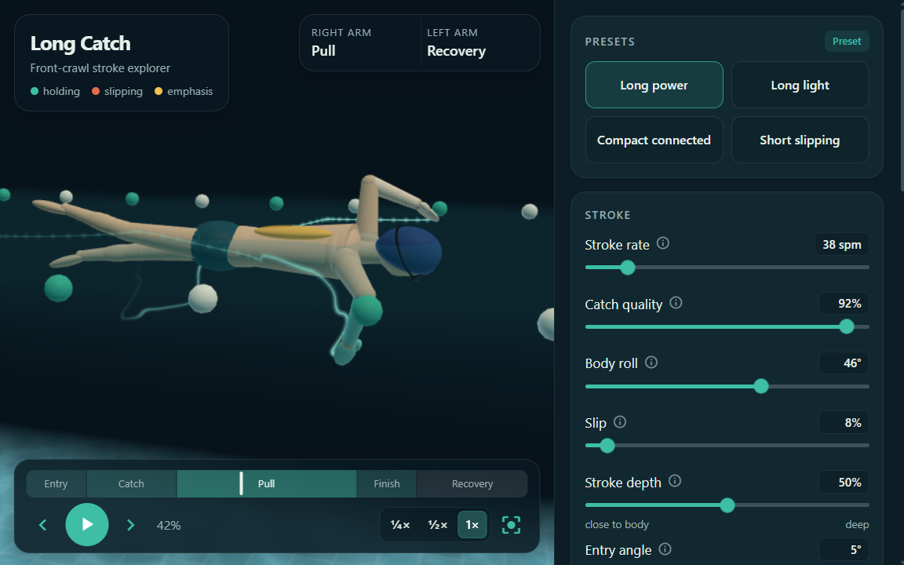
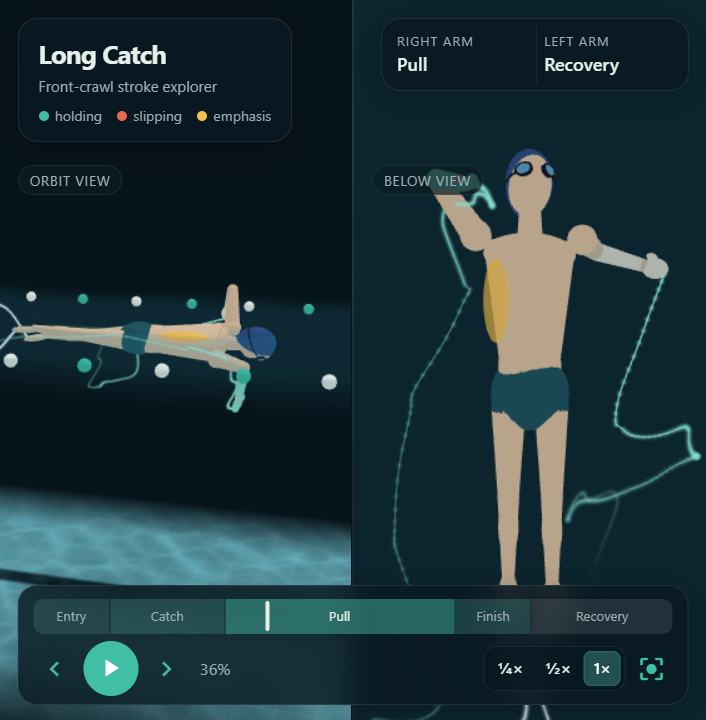
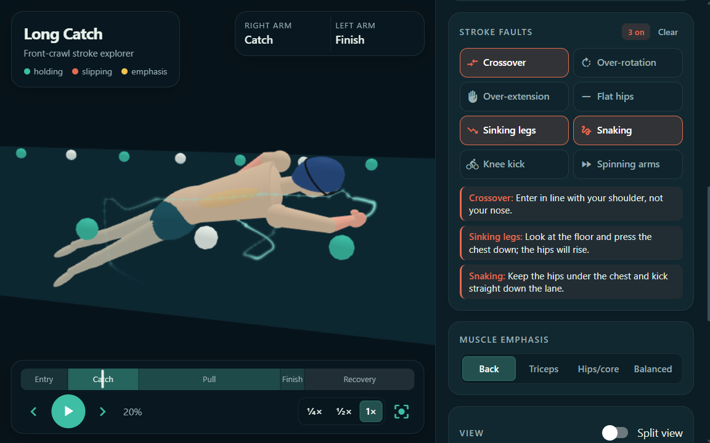
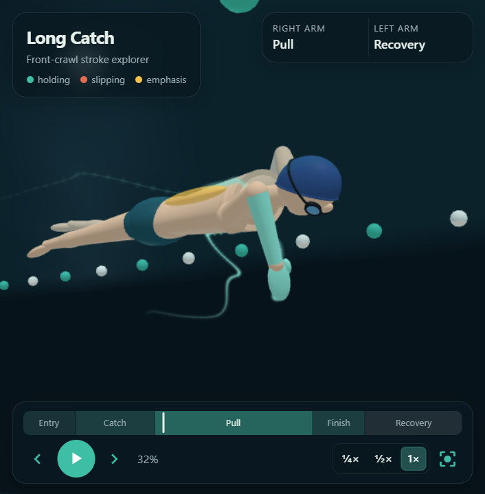
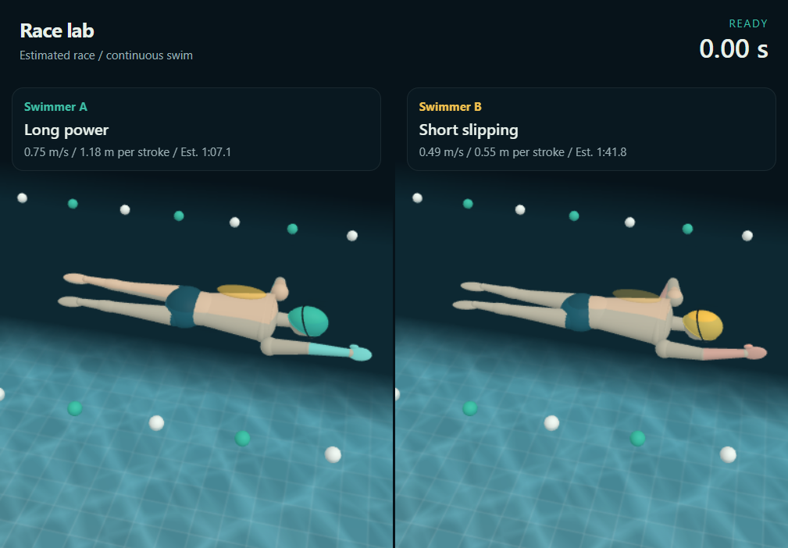
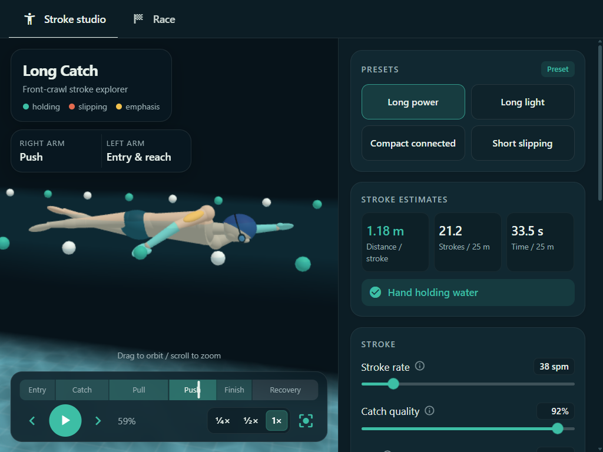
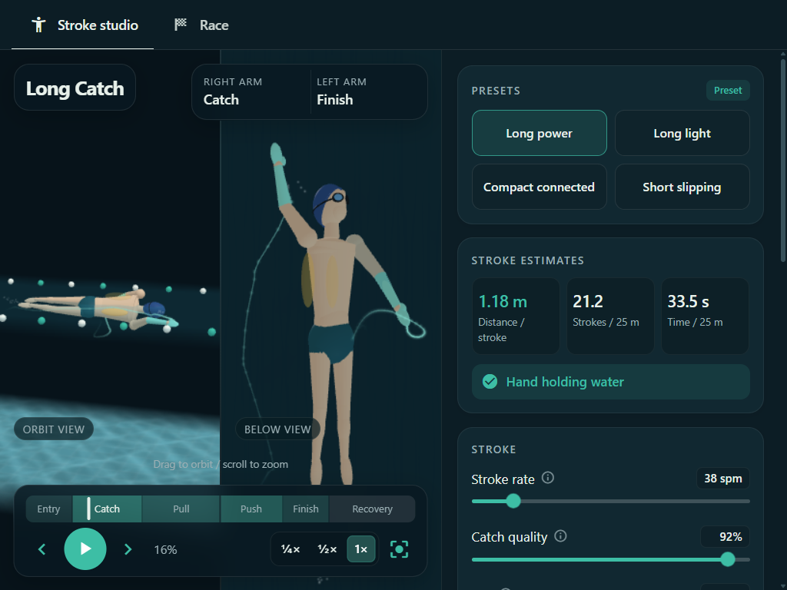

<h1 align="center">Long Catch</h1>

<p align="center">
  <strong>An interactive 3D explorer for front-crawl stroke technique.</strong><br>
  Shape a stroke, inspect common faults, and compare two swimmers over 25–100 m.
</p>

<p align="center">
  
  
</p>

<p align="center">
  
</p>

Long Catch runs locally with Python and [NiceGUI](https://nicegui.io).
Explore a procedural 3D swimmer in **Stroke studio**, or compare independent
setups in **Race**. No accounts, cloud services or downloaded models are needed.

## Gallery

<table>
  <tr>
    <td align="center" width="33%">
      <br>
      <sub><b>Split view</b> with motion trails.</sub>
    </td>
    <td align="center" width="33%">
      <br>
      <sub><b>Stroke faults</b> with coaching cues.</sub>
    </td>
    <td align="center" width="33%">
      <br>
      <sub><b>High-elbow catch</b> from underwater.</sub>
    </td>
  </tr>
</table>

## Features

- **Stroke controls:** eight adjustable settings, four presets and eight
  combinable faults with coaching cues.
- **Inspection:** orbit and split cameras, hand/foot trails, muscle highlighting,
  slow playback and a scrubbable six-phase timeline.
- **Feedback:** live distance-per-stroke, stroke-count and pace estimates.
  Hands turn teal when holding water and coral when slipping; amber highlights
  the selected muscle emphasis.
- **Water and motion:** stroke-driven ripples, spray, bubbles and wake, with
  natural breathing and subtle pace-dependent buoyancy.
- **Race:** solo or two-swimmer comparisons over 25, 50 or 100 m, with distance
  tracks, finish times and a winning margin.

## Quick start

**Requires Python 3.12.** Download or clone this repository, open a terminal in
its folder, then create and activate a virtual environment for your platform.

**Linux / macOS**

```bash
python3.12 -m venv .venv
source .venv/bin/activate
```

**Windows (Git Bash)**

```bash
py -3.12 -m venv .venv
source .venv/Scripts/activate
```

**Install and run**

```bash
python -m pip install -r requirements.txt
python main.py
```

Open <http://127.0.0.1:8080>. Keep the terminal running; press
<kbd>Ctrl</kbd>+<kbd>C</kbd> to stop. For later launches, reactivate the
environment and run `python main.py`.

### Deploy to Render

The repository includes a Render Blueprint in `render.yaml`. In Render, choose
**New → Blueprint**, connect this GitHub repository, then deploy. Render uses
Python 3.12, installs `requirements.txt`, and runs `python main.py`. The public
`.onrender.com` link works in Safari or Chrome on iPhone; free services may take
about a minute to wake after inactivity.

## Usage

### Stroke studio

1. Pick **Long power**, **Long light**, **Compact connected** or **Short slipping**.
   Editing a preset changes its label to **Custom**.
2. Tune **rate**, **catch**, **slip** and **drive**; estimates update above them.
   Expand **Motion details** for roll, depth, entry angle and kick.
3. Enable **stroke faults** to compare technique; **Clear** removes them all.
4. Drag to orbit, scroll to zoom, or enable **Split view** for a Top, Side,
   Front or Below camera. Add hand/foot trails to follow the paths.
5. Scrub the timeline to pause at **Entry → Catch → Pull → Push → Finish →
   Recovery**, or use slow playback. **Play** resumes.

Each hand entry counts as one stroke; a full arm cycle contains two.
More slip reduces distance per stroke, and extra drive cannot rescue a poor catch.

### Race

1. Choose **25 m**, **50 m** or **100 m**, then **Solo** or **Two swimmers**.
2. Select **Swimmer A** (teal) or **Swimmer B** (amber) to edit independent
   presets, controls and faults. **Use studio setup** copies your studio stroke;
   **Copy A to B** gives both lanes the same baseline.
3. **Start race**, pause/resume, or **Reset race**. Playback at **1x**, **2x**
   or **4x** changes viewing speed, not simulated finish times.
4. Follow the distance lead, then compare finish times and the winning margin.

Changing a setup, distance or swimmer count resets the race; selecting a lane
or reapplying an identical setup does not. Leaving Race pauses it. Studio
settings and playback remain independent.

**Model limits:** races use steady-speed estimates, without dives, turns or
fatigue. Roll, depth, entry angle and kick change appearance, not estimated
speed. Water effects and buoyancy are visual only and never alter results.

### Keyboard shortcuts

| Key | Action |
| --- | --- |
| <kbd>Space</kbd> | Play or pause |
| <kbd>←</kbd> / <kbd>→</kbd> | Step through the studio stroke |
| <kbd>1</kbd>–<kbd>4</kbd> | Select a studio preset |
| <kbd>C</kbd> / <kbd>V</kbd> | Reset studio camera / toggle split view |

Shortcuts respect focused controls. On the timeline, arrows step 5% and
Home/End seek to the cycle's start/end.

### Try it

<details open>
<summary><b>Compare two strokes over 50 m</b></summary>

Race **Long power** against **Short slipping**. For a controlled comparison,
copy A to B, then change only B's slip.



</details>

<details open>
<summary><b>Inspect the underwater push</b></summary>

Choose **Long power**, scrub to **Push** (about 60%) and select **Triceps**.
Orbit around the hand pushing toward the hip; step forward to inspect release.



</details>

<details open>
<summary><b>Check the catch from below</b></summary>

Enable **Split view → Below** and **Hands** trails. Scrub to **Catch** to
inspect the forearm, then try **Crossover** to compare the entry.



</details>

## Development

```bash
python -m pip install -r requirements-dev.txt
python -m pytest -q
ruff check .
ruff format --check .
```

The focused model suite covers timing, efficiency, faults, race results,
buoyancy bounds and input validation. For UI changes, also check both tabs,
lane isolation, playback, scrubbing, cameras and narrow layouts in a browser.
Restart the server after JavaScript or CSS edits.

`main.py` starts the app; `long_catch/model.py` owns pure maths,
`app.py` owns settings and UI, and `swimmer.py` builds the scene.
The browser's `static/engine.js` animates it; `static/race.js` shares a clock
between lanes. See [AGENTS.md](AGENTS.md) for architecture and contribution rules.